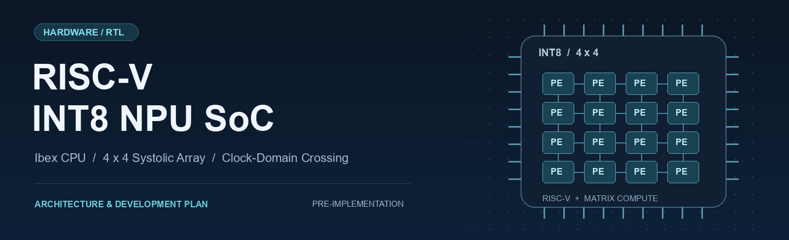
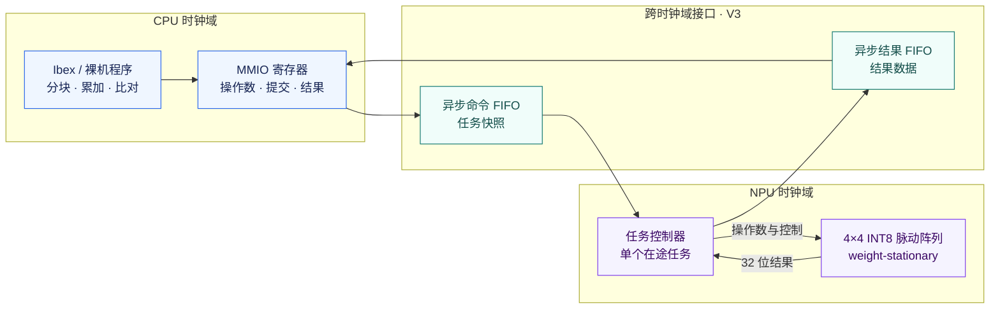

<div align="center">



# RISC-V INT8 NPU SoC

**从 INT8 矩阵计算到 RISC-V 软硬件协同的小型 SoC 设计。**

4×4 脉动阵列 · 裸机 MMIO · 异步 FIFO · 仿真与 FPGA 验证


[项目概览](#overview) · [系统架构](#architecture) · [计算与接口](#design) · [开发路线](#roadmap) · [工具链](#toolchain) · [文档导航](#docs)

</div>

> [!NOTE]
> **当前公开内容：项目规划、工具链选型与环境记录。** RTL、固件和测试脚本尚未加入，S0–V4 均未完成。上方徽章表示计划采用的技术，不代表已通过验证。

<a id="overview"></a>

## 项目概览

这个项目计划将一个 4×4 INT8 脉动阵列接入 Ibex RISC-V 系统，由裸机程序提交矩阵乘任务、读取结果，并与 Python 参考模型逐项比对。先完成单时钟版本，再通过异步 FIFO 分离 CPU 与 NPU 时钟域，最后进行 FPGA 验证。

项目的重点是把计算核、软件接口和验证流程连接起来：既检查矩阵结果，也检查数据在每个周期如何传递，以及任务在背压、复位和跨时钟域条件下如何完成。

### 设计范围

| 层次 | 计划内容 | 主要验证问题 |
|---|---|---|
| **计算核** | 4×4 weight-stationary 脉动阵列，INT8 输入、32 位累加 | 数值是否一致，逐拍数据流是否符合规格 |
| **系统集成** | Ibex 裸机程序通过 MMIO 控制 NPU | 提交、忙状态、结果读取与确认是否一致 |
| **跨时钟域** | 命令与结果分别经过异步 FIFO | 背压、满空边界与复位是否导致丢失或错序 |
| **工作负载** | 一个 16×16 量化全连接层 | 分块、部分和合并与重新量化是否正确 |
| **FPGA 验证** | 上板运行并记录时序、资源与性能 | 计算开销和系统开销各占多少 |

首版不包含完整 CNN 推理、DMA/AXI 子系统或 Linux 驱动。完整阶段范围见 [ROADMAP](docs/ROADMAP.md)。

<a id="architecture"></a>

## 系统架构

下图为 **V3 的目标结构**。V2 先使用单个时钟域，直接连接 MMIO 与任务控制器；V3 再加入命令和结果两个异步 FIFO。



颜色仅用于区分模块，所有模块均为计划内容。

### 一次任务的处理过程

| 步骤 | CPU / 软件侧 | NPU / 接口侧 |
|:---:|---|---|
| 1 | 写入 16 个 A 元素和 16 个 B 元素 | MMIO 暂存操作数 |
| 2 | 提交任务 | 对 `task_id/A/B` 建立原子快照；忙时拒绝新提交 |
| 3 | 等待并查询结果 | 阵列执行一个 4×4 矩阵乘任务 |
| 4 | 逐项读取结果 | 输出 16 个 32 位结果，最后一项带 `last` 标记 |
| 5 | 确认结果已读完 | 完成 ACK 后允许下一任务 |

双时钟版本中，结果 FIFO 满时暂停输出；软件在非空时持续读取，避免小深度 FIFO 因等待整批结果而阻塞。

<a id="design"></a>

## 计算与接口

### 计算核

一次硬件任务计算 `C = A × B`，其中 A、B 均为 4×4 矩阵，输出为 16 个 32 位结果。软件负责将更大的矩阵拆成多个任务，并合并部分和。

```text
C[i][j] = Σ(k=0..3) A[i][k] × B[k][j]
```

| 项目 | 设计约定 |
|---|---|
| 输入 | 有符号 INT8 |
| 累加与输出 | 32 位，首版不引入饱和运算 |
| 数据流 | weight-stationary，`PE(r,c)` 驻留 `B[r][c]` |
| PE 间传递 | 激活向东、部分和向南，每级寄存一拍 |
| 任务并发 | 单个在途任务 |
| 计算核复位 | 同步高有效，复位期间对外 `valid` 为 0 |

具体周期编号、装载与输出区间的重叠关系尚待逐拍时序表确认，原有时序草案保留在 [V1 计划](docs/ROADMAP.md) 中。

### 从矩阵任务到网络层

目标工作负载是量化模型中的一个 16×16 全连接层。硬件只处理 4×4 矩阵任务，软件负责：

1. 按阵列大小拆分输入和权重。
2. 提交各分块任务，沿完整 K 维合并部分和。
3. 进行零点修正，添加一次 bias，再执行重新量化与 ReLU。
4. 与独立 Python 参考结果逐项比较。

候选模型为 `hello_world_int8.tflite`；具体来源版本、层名、张量形状和量化参数将在 V2 阶段核实并记录。

<a id="roadmap"></a>

## 开发路线

按计算核、系统集成、跨域通信、板级验证依次推进，每个阶段保留可复现的测试与报告。

| 阶段 | 目标 | 主要交付 | 状态 |
|:---:|---|---|:---:|
| **S0** | 工具链验证 | 最小 RTL、自检测试、仿真与综合入口 | 未完成 |
| **V1** | 独立计算核 | PE 与阵列、参考模型、逐拍测试、综合报告 | 未完成 |
| **V2** | 单时钟 SoC | Ibex 裸机基线、MMIO、真实网络层比对 | 未完成 |
| **V3** | 双时钟 SoC | 异步 FIFO、复位与背压测试、形式验证 | 未完成 |
| **V4** | FPGA 验证 | 板卡配置、时序约束、资源与性能记录 | 未完成 |

<details>
<summary><strong>查看各阶段的验证重点</strong></summary>

- **S0**：除正常通过路径外，验证错误期望值和 X/Z 注入能使回归失败，失败退出码能传递到统一入口。
- **V1**：手算样例、单位阵、极值和固定种子随机向量逐元素一致；逐拍检查能够发现时序错误。
- **V2**：由真实 Ibex 裸机程序提交任务并读回结果，同时保留纯软件计算的周期基线。
- **V3**：覆盖不同频率比、非对齐相位、满空边界和在途复位，对 FIFO 的数据顺序与边界条件进行形式验证。
- **V4**：区分阵列计算时间与端到端时间，记录测量条件，比较频率比与 FIFO 深度的影响。

完整设计约束、交付物与验收条件见 [docs/ROADMAP.md](docs/ROADMAP.md)。

</details>

<a id="toolchain"></a>

## 工具链

主开发环境为 WSL2 Ubuntu，计划在同一 shell 下运行主仿真、综合与回归。四态仿真计划通过路径转换调用 Windows 侧的 Icarus Verilog。

| 工具 | 本地记录版本 | 计划用途 |
|---|---|---|
| Verilator | 5.032 | 主仿真 |
| Yosys | 0.52 | PE 与阵列综合 |
| Python | 3.14.4（WSL） | 整数参考模型、向量生成与结果检查 |
| Icarus Verilog | 14.0（Windows，仅探测） | 四态仿真与 X/Z 注入测试 |

这些版本来自 [环境记录](env/tool_versions.txt)，兼容范围和统一回归入口尚未验证。Ibex 版本与裸机交叉编译工具链将在 V2 阶段固定。工具链的备选方案及选型理由见 [ADR-0001](docs/decisions/ADR-0001-s0-toolchain.md)。

<a id="docs"></a>

## 文档导航

| 文档 | 内容 |
|---|---|
| [阶段计划](docs/ROADMAP.md) | S0–V4 的设计草案、验收条件与交付物 |
| [工具链选型](docs/decisions/ADR-0001-s0-toolchain.md) | 开发环境的选择理由与验证范围 |
| [本地环境记录](env/tool_versions.txt) | 工具探测结果、版本与初始环境路径 |

### 当前仓库内容

```text
.
├── README.md
├── assets/
│   └── readme-hero.png                    # 首页横幅
├── docs/
│   ├── ROADMAP.md                         # 阶段计划
│   └── decisions/
│       └── ADR-0001-s0-toolchain.md        # 工具链决策
└── env/
    └── tool_versions.txt                  # 本地环境记录
```

<details>
<summary><strong>后续代码目录规划（尚未加入）</strong></summary>

| 目录 | 内容 |
|---|---|
| `rtl/core/` | PE、阵列与公共类型 |
| `rtl/soc/` | MMIO、系统顶层与结果适配 |
| `rtl/cdc/` | 异步 FIFO 与跨域接口 |
| `tb/` | 计算核、MMIO 与 SoC 自检测试 |
| `model/`、`vectors/` | Python 参考模型与确定性向量 |
| `sw/` | 裸机启动代码、链接脚本与自检程序 |
| `scripts/` | 向量生成、检查与回归入口 |

</details>

## 参考项目

- [lowRISC Ibex](https://github.com/lowRISC/ibex)：计划集成的 RISC-V CPU 核。
- [TensorFlow Lite Micro](https://github.com/tensorflow/tflite-micro)：量化网络层的候选来源。

## 许可

本项目尚未选定开源许可证。

<div align="right">

[返回顶部 ↑](#risc-v-int8-npu-soc)

</div>
