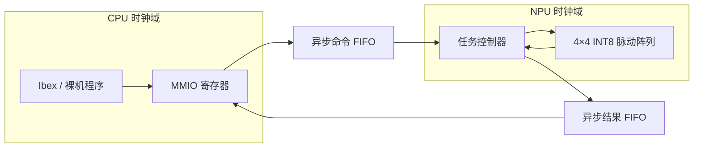

# RISC-V INT8 NPU SoC

基于 Ibex RISC-V 核与 4×4 INT8 脉动阵列的小型 SoC 设计项目，关注矩阵计算、软硬件接口和跨时钟域通信。

**当前处于规划阶段。** 本次公开内容为设计计划、工具链选型和本地环境记录，尚未包含 RTL、固件或可运行的测试。

## 设计目标

从独立计算核开始，逐步接入 CPU、跨时钟域接口和 FPGA 验证。目标是让裸机程序通过 MMIO 提交矩阵乘任务，读回结果，并与独立参考模型逐项比对。

| 模块 | 计划方案 |
|---|---|
| CPU | lowRISC Ibex，运行裸机程序 |
| 计算核 | 4×4 weight-stationary 脉动阵列，有符号 INT8 输入、32 位累加 |
| 软硬件接口 | MMIO，单个在途任务，显式提交与结果确认 |
| 时钟域 | 先完成单时钟系统，再通过异步命令 FIFO 和结果 FIFO 分离 CPU 与 NPU 时钟域 |
| 工作负载 | 量化模型中的一个 16×16 全连接层，包含软件分块、累加与重新量化 |
| 验证 | Python 整数参考模型、RTL 自检、综合报告，后续补充 FPGA 实测 |

首版范围限于矩阵计算及其系统集成，不包含完整 CNN 推理、DMA/AXI 子系统或 Linux 驱动。

## 目标架构

以下为目标结构，尚未实现。单时钟版本先直接连接 MMIO 与任务控制器，双时钟版本再加入异步 FIFO。



一次硬件任务计算 `C = A × B`，其中 A、B 均为 4×4 矩阵，输出为 16 个 32 位结果。软件负责将更大的矩阵拆成多个任务，并合并部分和。

## 开发计划

| 阶段 | 内容 | 完成依据 |
|---|---|---|
| S0 | 工具链验证 | 仿真、自检失败路径、综合和干净重建通过 |
| V1 | 独立计算核 | 数值与逐拍检查通过，保留 PE 和阵列综合报告 |
| V2 | 单时钟 SoC | Ibex 裸机程序完成任务提交、结果读取和真实网络层比对 |
| V3 | 双时钟 SoC | 异步 FIFO 验证、复位与背压测试通过 |
| V4 | FPGA 验证 | 上板运行，记录时序、资源和性能数据 |

以上阶段均未完成。详细设计约束与验收条件见 [阶段计划](docs/ROADMAP.md)。

## 工具链

计划以 WSL2 Ubuntu 为主要开发环境，使用 Verilator 仿真和 Yosys 综合；四态仿真计划使用 Windows 侧的 Icarus Verilog。当前仓库尚无构建入口。

| 工具 | 已记录版本 | 用途 |
|---|---|---|
| Verilator | 5.032 | 主仿真器 |
| Yosys | 0.52 | RTL 综合 |
| Python | 3.14.4（WSL） | 参考模型与检查脚本 |
| Icarus Verilog | 14.0（Windows，仅探测） | 计划用于四态仿真 |

本地工具版本见 [env/tool_versions.txt](env/tool_versions.txt)，选型理由见 [ADR-0001](docs/decisions/ADR-0001-s0-toolchain.md)。这些版本是当前开发环境的记录，兼容范围尚未验证。Ibex 版本及裸机交叉编译工具链将在 V2 阶段固定。

## 仓库内容

当前提交的主要文件：

```text
.
├── README.md
├── docs/
│   ├── ROADMAP.md                         # 阶段计划与验收条件
│   └── decisions/
│       └── ADR-0001-s0-toolchain.md        # 工具链选型记录
└── env/
    └── tool_versions.txt                  # 本地环境记录
```

RTL、测试平台、参考模型和固件将在对应阶段加入仓库。

## 参考项目

- [lowRISC Ibex](https://github.com/lowRISC/ibex)：计划集成的 RISC-V CPU 核。
- [TensorFlow Lite Micro](https://github.com/tensorflow/tflite-micro)：量化网络层的候选来源，具体模型与版本将在 V2 阶段确认。

## 许可

本项目尚未选定开源许可证。
