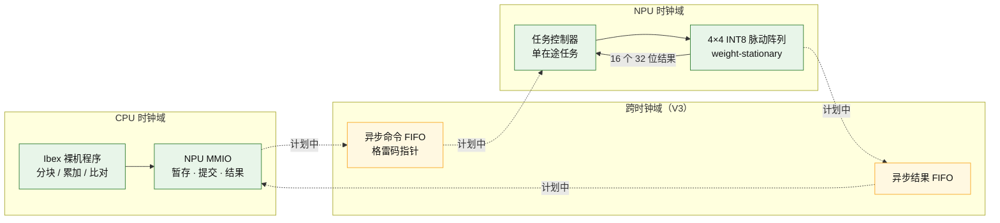

<div align="center">

# RISC-V INT8 NPU SoC

**把一个能跑 INT8 矩阵乘的脉动阵列，接上 RISC-V 核，做成一颗说得清楚的小 SoC。**

从板级系统走向芯片级系统设计的一次完整练习。


[项目概览](#项目概览) · [为什么做这个](#为什么做这个) · [路线图](#路线图) · [架构](#架构) · [环境](#环境) · [目录](#目录结构) · [文档](#文档)

</div>

> [!NOTE]
> **当前状态：规划阶段。** 仓库里目前只有项目规划和工具链记录，RTL 还没开始写。
> 每个阶段的完成标准和交付物见 [docs/ROADMAP.md](docs/ROADMAP.md)，只有在那里打勾的阶段才算做完。

## 项目概览

这个项目要做一颗**小型的边缘推理 SoC**：一颗 RISC-V 核（Ibex）通过 MMIO 把任务交给一个 INT8 脉动阵列，算完把结果读回来，两个时钟域之间用异步 FIFO 隔离。

规模刻意做小，是为了每一步都能验证清楚：

- 计算核：4×4 有符号 INT8 weight-stationary 脉动阵列，32 位累加，一次算一个 4×4×4 的矩阵乘
- 系统：Ibex 裸机程序写操作数 → 提交任务 → 读回 16 个结果 → 和 Python 参考值逐项比对
- 工作负载：不是随机矩阵，而是一个已量化模型的真实全连接层（`16×16`，融合 ReLU，全整数 PTQ）
- 时钟：CPU 域和 NPU 域分开，命令和结果各走一个异步 FIFO，指针用格雷码跨域

**这不是什么**：不是训练模型，不是商业 NPU，不做完整 CNN、不做 DMA/AXI 大系统、不做 Linux 驱动。这些都不在主链路里。

## 为什么做这个

大二学完数字电路之后接触了 FPGA，第一次把一段 Verilog 烧进板子、看着灯按自己写的状态机动起来，那种感觉和写软件完全不一样——你能指着它说"这个逻辑是我造的"。

顺着 FPGA 往下看，才知道底下还有一条更长的路：同一份 RTL，经过综合、布局布线、时序收敛，最后能变成一颗真的芯片。那时候我补了不少课：数字电路的时序分析、SystemVerilog 的坑、仿真器怎么用、综合工具报的 warning 是什么意思。学一阵子就发现，光看是没用的，必须有一个能从头做到尾的项目。

所以有了这个仓库。它的定位很明确：**先用仿真把一颗小 SoC 的每一拍都讲清楚，再谈更下面的东西**。我想走的路线是从板级系统走向芯片级系统设计——先把 RTL 写到能跑、能验证、能综合，再谈物理实现。

项目拆成几个能独立收口的阶段，做不完就停在能交代的地方，不硬撑：

| 阶段 | 我想要的 | 做不出来就停在哪 |
|---|---|---|
| S0 | 仿真/综合/回归一条命令跑通 | 工具都没跑通就别谈 RTL |
| V1 | 一个真的会逐拍搬数据的脉动阵列 | 只有阵列，也能叫"INT8 阵列设计与验证" |
| V2 | 裸机程序真的能调用它 | 单时钟 SoC，也能交代 |
| V3 | 两个时钟域可靠通信 | CDC 是这套东西里最难也最值钱的部分 |
| V4 | 上板、时序、实测数据 | 到不了就如实写"没上板" |

## 路线图

| 阶段 | 内容 | 关键交付 | 状态 |
|:---:|---|---|:---:|
| **S0** | 工具链闭环：二态/四态仿真、综合、干净重建 | 自检 tb + 一键脚本 | ⬜ |
| **V1** | INT8 PE、4×4 阵列、Python golden、逐拍自检、双顶层综合 | 规格 + 向量 + RTL + 综合报告 | ⬜ |
| **V2** | Ibex 裸机基线 → NPU MMIO → 真实 16×16 层 | 裸机固件 + MMIO + 对拍记录 | ⬜ |
| **V3** | 双时钟域：异步命令/结果 FIFO、复位与背压、形式验证 | CDC 规格 + 性质 + 频率比实验 | ⬜ |
| **V4** | FPGA 上板、时序约束、吞吐与资源实测 | 约束 + 报告 + 对照表 | ⬜ |

> 低阶段的成果不能当高阶段用。没上板就不写"FPGA 实现"，没做 STA 就不写"时序收敛"。

## 架构



绿色是已经规划清楚、单时钟内能跑通的部分；黄色是 V3 才接的双时钟域，现在只有方案。

**数据通路**：CPU 写 16 个 A 元素和 16 个 B 元素到暂存区 → 提交时把 `task_id/A/B` 原子快照 → 阵列按"装载 4 拍、注入 16 拍、捕获 16 拍"跑完 → 结果按 16 beat 逐项读出，末项带 `last`。
**控制通路**：一次只有一个在途任务，忙时提交被拒且不覆盖；结果没被 ACK 之前 MMIO 不放行下一个任务。

## 环境

```bash
# WSL2 Ubuntu，RTL 全部在 Linux 路径下跑
sudo apt install -y verilator yosys gtkwave build-essential
# 四态仿真用 Windows 侧的 Icarus，通过 wslpath 转路径
# 裸机交叉编译
sudo apt install -y gcc-riscv64-unknown-elf
```

| 工具 | 版本 | 用途 |
|---|---|---|
| Verilator | 5.032 | 二态仿真（快，但不建模 X/Z） |
| Icarus Verilog | 14.0 | 四态仿真，专门用来抓 X/Z 和协议违规 |
| Yosys | 0.52 | 综合，看资源和锁存器 |
| riscv64-unknown-elf-gcc | 14.2.0 | 裸机固件 |
| Python | 3.14 | 参考模型、向量生成、检查脚本 |

为什么两个仿真器：Verilator 快但不建模 X/Z，四态检查只能靠 Icarus。这条是踩过坑才定下来的，写进了 [ADR-0001](docs/decisions/ADR-0001-s0-toolchain.md)。

## 目录结构

```text
riscv-int8-npu-soc/
├── rtl/
│   ├── core/            # PE、4×4 阵列、公共类型
│   ├── soc/             # MMIO、系统顶层、结果适配
│   └── cdc/             # 异步 FIFO（V3）
├── tb/
│   ├── core/            # 逐拍 scoreboard、故障注入
│   └── soc/             # MMIO 单元 tb、真实 Ibex 系统 tb
├── model/               # Python 纯整数参考模型
├── vectors/             # 固定种子的确定性测试向量
├── sw/                  # 裸机固件（启动、链接脚本、自检）
├── scripts/             # 检查器、生成器、一键回归
├── docs/
│   ├── ROADMAP.md       # 阶段计划与完成标准
│   ├── architecture/    # 数值契约、接口规格、逐拍时序
│   └── decisions/       # 决策记录（为什么这么选）
└── env/                 # 实际工具版本
```

## 设计约定

几条一开始就定死、后面不许偷偷改的规则：

- **数值**：操作数有符号 INT8，累加 32 位，不定义溢出/饱和；`C[i][j] = Σ A[i][k]·B[k][j]`
- **映射**：`PE(r,c)` 驻留 `B[r][c]`，激活向东、部分和向南，每级只寄存一拍；禁止用组合 GEMM 冒充脉动阵列
- **时序**：装载 4 拍 / 注入 16 拍 / 捕获 16 拍；接受后 24 拍出最后结果、25 拍可握手、最小任务间隔 26 拍
- **复位**：同步高有效，复位优先于一切；复位期间对外 `valid` 必须为 0
- **验证**：Python 参考模型和 RTL 各自独立算，任何一个"自己证明自己"都不算数
- **文档**：改规格要先改文档再改代码，不许实现里静默改契约

## 文档

| 文档 | 内容 |
|---|---|
| [docs/ROADMAP.md](docs/ROADMAP.md) | 每个阶段做什么、做到什么算完 |
| [docs/decisions/](docs/decisions/) | 为什么用 WSL + Verilator、为什么选 weight-stationary |
| [docs/architecture/](docs/architecture/) | 数值契约、接口、逐拍时序（随阶段补） |

## 参考

- [lowRISC Ibex](https://github.com/lowRISC/ibex)：CPU 基线，版本锁在 `deps/ibex.lock.json`
- [tflite-micro](https://github.com/tensorflow/tflite-micro)：工作负载来源（`hello_world_int8` 的第二层）
- 脉动阵列与 weight-stationary 数据流的基本思路来自课上的体系结构内容和公开讲义

## 许可

个人练习工程，暂未选定开源许可。第三方部分按各自许可引用（Ibex 为 Apache-2.0）。

<div align="center">
<sub>边学边做，做一步记一步。</sub>
</div>
